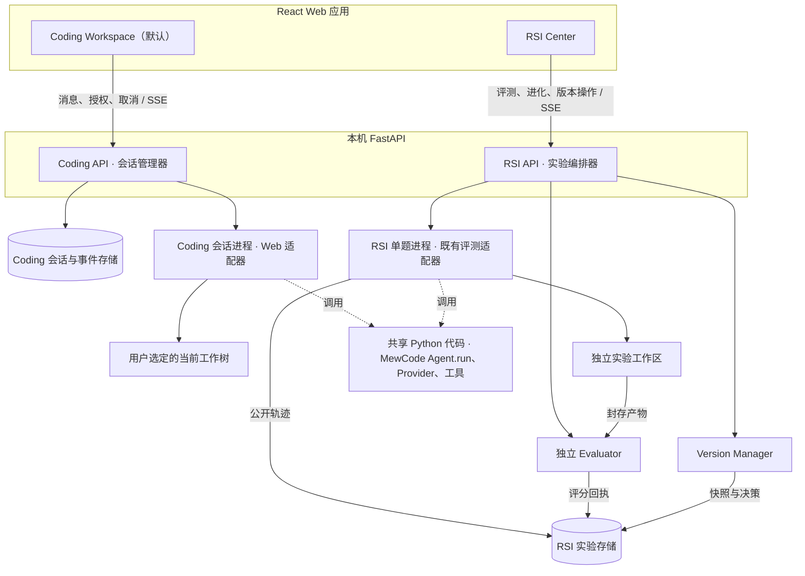

# Coding Agent Workspace 与 RSI Center 技术设计

状态：已批准。2026-11-24 用户确认文件组织与五阶段实施安排，并批准整份技术设计。设计依据为已批准的 [产品规格与验收标准](spec.md)。

## 架构概览

沿用一套 React 前端和一个本机 FastAPI 入口。默认路由进入 Coding Workspace，RSI Center 有独立路由。前端可以共用导航外壳、Diff 和事件展示组件，分别订阅普通会话与实验的数据。后端将 Coding 会话管理与 RSI 编排分开装配。MewCode 的 Python 执行代码由两侧直接调用，每个执行进程各自创建 Agent、模型客户端、工具注册表和权限检查器。

### 两条执行路径

**Coding Workspace。** 浏览器把任务提交给 Coding 会话管理器。管理器绑定仓库、会话和轮次，保存用户消息，按需启动该会话专属的本地进程。进程以用户选定的目录为工作目录，使用原生 `Agent.run()`、对话管理、工具、权限、Skills、MCP 与 Hooks。Web 适配器把 MewCode 事件交回管理器，并把用户对特定调用的授权送回原进程。管理器先持久化事件，再通过 SSE 发布。浏览器关闭只结束订阅，后台进程继续执行。现有 TUI 和远程入口均有可复用的装配逻辑，远程入口的 Agent、会话和当前目录属于同一服务实例，Web 在专属进程中建立这些对象。[原生执行循环](../../mewcode/agent.py) · [TUI 装配](../../mewcode/app.py) · [现有远程入口](../../mewcode/remote.py)

**RSI Center。** 实验编排器按冻结题集、被测配置和 Harness 快照调度单题运行。现有 `mewcode.rsi.runtime.MewCodeRuntime` 负责验证运行条件、准备临时工作区，在子进程中通过 `CellAgent` 调用同一个 `Agent.run()`。单题结束后封存公开轨迹与代码产物。Evaluator 读取封存产物并出具回执，Version Manager 根据评测证据处理版本决策。Coding 请求直接走普通会话路径，无需冻结题集、评分容器、实验数据库或演示模型服务。后端把这些设施的初始化归入 RSI 或显式选择的演示配置，使 RSI 启动失败时 Coding 入口仍可用。[评测适配器](../../mewcode/rsi/runtime.py) · [单题工作区](../../mewcode/rsi/workspace.py) · [实验编排](../../mewcode/rsi/orchestrator.py) · [现有 Web 启动逻辑](../../webdemo/api.py)

### 状态归属

| 边界 | Coding Workspace | RSI Center |
| --- | --- | --- |
| 身份与生命周期 | 普通会话绑定一个实际仓库，按轮次接收任务，同一会话同一时刻执行一轮。活跃会话独占其进程和模型上下文，空闲释放后可从记录重建。 | 实验包含多次单题运行。每次运行绑定题目、重复次数、被测配置和快照，实验编排器持有调度、取消与恢复权。 |
| 工作区与权限 | 直接操作用户工作树，读取未提交改动。服务端按实际工作树身份协调写入，路径别名归到同一把写锁。写文件及可能写入的 Shell、扩展或 Hook 都受约束。取消后待相关子进程失去写入能力才释放。只读查看可继续。 | 每次单题运行从指定输入建立独立工作区，使用冻结工具策略、受限测试环境和自己的临时目录。评分器单独访问私测。实验权限只在该实验内生效。 |
| 配置与凭据 | 会话选择自己的 Coding 配置。每轮开始固定实际 Provider、模型和权限配置，选用的新 Provider 从下一轮生效。依原生规则记录持续授权的适用范围。 | 实验固定 Benchmark、被测 Provider、预算及起始 Harness，每个单题绑定实际受测快照。优化器配置单独选择。活动版本变更只用于后续选择，既有运行继续使用其快照。 |
| 存储与恢复 | 建议由仓库外的 Coding 专用存储持有 Web 会话索引、轮次、消息、原生压缩边界和可续读事件。复用 MewCode 的消息记录与压缩恢复语义，以同一份持久记录重建 UI 时间线和模型上下文。现有 CLI/TUI 会话继续按原格式恢复。 | Web 实验作业日志、引擎控制库、封存产物和只读历史归档沿用现有存储。评分真值取自 Evaluator 回执，活动版本仅由 Version Manager 写入。Web 页面从对应来源读取。 |

原生 Agent 默认从工作目录推导会话记录和长工具输出的位置。Web 适配器需要将当前会话的记录视图与工具输出文件定位到仓库外的专属目录，使压缩及工具结果回读都指向同一会话。若服务重启时执行已丢失，会话管理器恢复已保存的消息和工具记录，将该轮标为中断。已发出但未记录结果的写操作标为结果未知，由用户查看 Diff 后决定下一步。[原生会话路径](../../mewcode/agent.py) · [会话与压缩恢复](../../mewcode/memory/session.py)

服务端共用 Provider 配置解析、客户端工厂和凭据读取能力。两侧分别保存自己的选择，运行记录仅持有非秘密配置和凭据引用。调用模型所需的密钥通过私有通道交给对应客户端，工具、Shell 和测试进程使用清理过的环境。普通仓库、实验工作区和模型凭据存储分别设定可访问范围。[Provider 配置](../../mewcode/config.py) · [现有 RSI 存储](../../webdemo/store.py)

### 两个明确的跨模块入口

- **提交候选任务（F23）。** 用户从指定轮次选择起始代码、题面和可公开验证材料，预览后提交。RSI 保存独立候选副本。后续普通会话修改工作树时，候选内容仍以提交时的材料为准。
- **选用已验证版本（F24）。** 用户在独立 Coding 配置中选定 RSI 已验证的 Harness，服务端解析并保存不可变快照引用及其可用内容。日常启动使用这个固定版本。RSI 后续晋升或主动回滚（F20）只更新该实验谱系的活动引用。

这一拆分保留现有冻结基准。当前冻结校验将 MewCode 原生包的大部分文件及依赖锁纳入 Runtime 摘要。新增 Web 装配与会话管理优先放在 Web 层，直接复用原生组件。涉及冻结输入的变更须显式处理运行版本与历史兼容，旧实验始终保留原摘要和回执。[冻结输入定义](../../mewcode/rsi/fixtures.py) · [版本管理](../../mewcode/rsi/versions.py)

## 核心数据结构

一次 Web **轮次**指用户提交一条消息后，Agent 为完成这条请求所做的全部模型调用和工具执行。一个会话可以有多轮。工具事件属于具体轮次，写入权属于实际工作树，执行配置在受理该轮时固定。

| 对象 | 主标识 | 关联与数量 |
| --- | --- | --- |
| 会话 `CodingSession` | `session_id`，服务端生成的 UUID | 绑定一个 `worktree_id` 和一个起始工作目录。一个工作树可绑定多个会话。 |
| 轮次 `CodingTurn` | `turn_id`，服务端生成的 UUID | 恰属一个会话并引用一个 `snapshot_id`。每个会话至多有一个未结束轮次。 |
| 事件 `CodingEvent` | `(session_id, seq)`，序号在会话内单调递增 | 本节的执行事件均携带 `turn_id`，且该轮必须属于同一会话。一个轮次有多条事件。 |
| 工作树写入权 `WorktreeWriteLease` | 当前记录以 `worktree_id` 为键，每次取得写入权由 `(worktree_id, generation)` 唯一标识 | 每个工作树至多一个持有轮次。轮次只可取得其会话所绑定工作树的写入权。 |
| 配置快照 `CodingConfigSnapshot` | `snapshot_id`，按规范化内容计算的 SHA-256 摘要 | 多个轮次可以引用相同快照。快照可选引用一个已验证的 Harness 内容摘要。 |

会话、轮次、事件和写入权的权威记录由 Coding 会话管理器写入仓库外的 SQLite 存储。进程持有的 Agent、授权等待对象和浏览器订阅均为临时对象。以下时间字段使用 UTC，事件顺序以持久化序号为准。

### 会话与轮次

**CodingSession。** 持久字段为 `session_id`、`worktree_id`、`cwd_relative`（起始目录相对工作树根的位置）、`profile_id`（下轮使用的 Coding 配置）、`title`、`created_at`、`last_active_at`。创建时固定工作树和起始目录，换仓库会创建或打开另一会话。关闭页面或释放空闲进程后，会话仍可按原 ID 打开。恢复时重验工作树身份和起始目录，目录失效时允许查看历史并阻止新执行。界面上的运行状态从当前轮次读取。

**CodingTurn。** 持久字段为 `turn_id`、`session_id`、`submit_request_id`、`snapshot_id`、`state`、`accepted_at`、可空的 `started_at`、`ended_at`、`end_reason` 及 `worker_instance_id`（执行进程每次启动时生成，接手轮次后绑定）。受理提交时，在同一事务内登记请求、固定快照、创建轮次并追加用户消息。提交方为一次发送生成稳定的请求 ID，响应丢失后沿用该 ID。`(session_id, submit_request_id)` 唯一，同一请求与内容返回原轮次，同一 ID 携带不同内容返回冲突。两个不同提交争用同一会话时，数据库只允许一个未结束轮次，另一方取得占用轮次标识。

| 当前状态 | 可进入的状态 | 触发条件 |
| --- | --- | --- |
| `accepted` | `running`、`cancelling`、`failed`、`interrupted` | 执行进程确认接手、启动前取消、启动失败或服务丢失执行。 |
| `running` | `waiting_permission`、`cancelling`、`completed`、`failed`、`interrupted` | 遇到待授权调用、接受取消、整条用户请求正常结束、失败或执行丢失。 |
| `waiting_permission` | `running`、`cancelling`、`failed`、`interrupted` | 有效授权答复交回原调用后继续。拒绝结果也可交回 Agent，由它选择后续动作。 |
| `cancelling` | `cancelled`、`interrupted` | 清理确认后标为已取消。执行丢失时记录中断，工作树写入权独立保留到确认安全释放。 |
| `completed`、`failed`、`cancelled`、`interrupted` | 终态 | 同一事务提交一次终态及对应事件。后到的完成或取消请求只能读取已决定的结果。用户继续工作时创建新轮次。 |

原生 `TurnComplete` 表示 Agent 内部一次迭代结束。会话管理器在整次执行返回并核对最后结果后，才提交 Web 轮次的终态。取消与完成同时到达时，按首次成功的条件状态更新裁决。若取消先获受理，后续只走清理路径。[原生事件定义](../../mewcode/agent.py)

### 事件、授权与恢复

**CodingEvent。** 除主标识与轮次外，事件含 `kind`、`schema_version`、`recorded_at`、`source_id`（同一来源事件重送时保持稳定）及由 `kind` 定义的 `payload`。管理器在事务中去重、分配序号并追加事件，提交后才发布 SSE。管理器校验来源实例与轮次绑定。工作进程用自身实例 ID 和本地递增序号标识来源，服务端操作用操作 ID 和事件序号标识来源。一个事件再次送达时返回已有位置。

| 事件内容 | 关联与有效期 |
| --- | --- |
| 消息及压缩 | 同一消息的流式片段与定稿使用同一 `message_id`。界面将片段合并成一条消息。模型恢复只读取已提交的原生消息记录，从最后有效压缩边界的摘要、保留消息及边界之后的记录重建。历史时间线仍可查看早期事件。 |
| 工具与授权 | 每个调用分配会话管理器可识别的 `call_id`，以 `(turn_id, call_id)` 关联请求、授权和结果，同时保留 Runtime 的工具 ID 与模型迭代位置。同名并行调用分别记录。授权事件另有一次性 `permission_id`，绑定本轮、调用和工作进程实例。原生权限请求只有工具名称、描述和等待对象，Web 适配器须在收到带工具 ID 的实际调用上下文中建立绑定。无法唯一关联时停止该调用。 |
| 状态与执行证据 | 用户操作、状态迁移、命令输出、错误、用量和摘要均保留来源。有副作用的调用在派发前持久化执行意图，收到实际结果后追加结果事件。进程丢失而记录只有意图时，界面标为「执行结果未知」并提供 Diff。恢复只重建历史，新的执行需要新的用户操作。 |

SSE 游标编码为 `session_id/seq`，客户端只保存最后已应用的位置。重连时服务端按会话校验游标，依次补发后续已提交事件。失效游标触发历史重建，响应携带同一读取时点的最新序号，之后从该位置续读。断线期间待授权操作仍可从服务端查询。只有还在原进程中等待的请求可以答复，一旦取消或进程丢失，旧请求立即失效。权限答复、取消等操作按所属对象与请求 ID 登记处理结果，重送只返回既有结果。[原生会话记录与压缩边界](../../mewcode/memory/session.py) · [现有 Web 事件日志](../../webdemo/store.py)

### 工作树写入权

**工作树身份。** `worktree_id` 为服务端登记的 UUID。登记时解析 Git 实际工作树根目录，记录规范根路径、根目录与工作树专属 Git 管理目录的文件系统身份（本机使用设备号和文件序号）。路径别名和同一树下的不同起始目录命中同一登记。两个 Git linked worktree 即使共享对象库，各有自己的根和登记。开始新轮及取得写入权前重新核对身份，原路径被另一仓库替换时阻止沿用旧绑定。

**WorktreeWriteLease。** 记录包含 `worktree_id`、单调递增的 `generation`、`state`（`free`、`held`、`draining`），及持有期间的 `holder_turn_id`、`worker_instance_id`、受管进程组的系统标识与启动身份（防止 PID 重用）、`acquired_at`。持有会话由轮次外键确定。服务端是写入权的唯一授予方。

1. 只读查看无需取得写入权。文件编辑、可能写入的 Shell、扩展与 Hook 在首次可能产生副作用前，必须完成权限校验并取得本代写入权。原子更新 `free → held`，分配新代号。若已被其他轮次持有，返回占用会话，调用方可在释放后重试。
2. 每次写入派发和释放均校验工作树、持有轮次、进程实例与代号。写操作及其可写子进程全部完成后可释放，后续写入重新竞争。编辑前还需核对上次读取的内容版本，处理编辑器造成的外部改动。
3. 取消、进程失联或服务重启后，尚待核对的占用进入 `draining`。心跳超时只触发检查。只有确认原执行及其子进程已失去写入能力才能回到 `free`，保留最后代号。迟到的旧进程消息无法释放新持有者的写入权。即使上一轮已标为中断，清理未完成时仍可读、不可交接写入。

### 配置快照与 RSI 引用

**CodingConfigSnapshot。** `snapshot_id` 的输入含格式版本、Provider 身份与协议、无秘密的端点、模型与推理参数、权限模式与策略版本、沙箱配置、已启用的 Skills/MCP/Hooks 配置版本、执行预算，以及可空的 Harness 引用。凭据只记录不可反查密钥的服务端版本引用。可变配置或本地文件的有效内容需在受理时固定为不可变版本或内容引用，后续解析可用摘要核验。摘要、事件和客户端响应均不包含明文密钥。

受理每轮时解析会话的 `profile_id`。相同规范内容可以复用快照，配置改动只影响之后受理的轮次。快照和所引用的非秘密内容至少保留到引用它的历史可查期结束。派发新调用前仍须检查凭据撤销和强制拒绝规则。运行记录保留原快照，并记录本次拒绝原因。用户做出的逐调用授权和持续授权决定另行记录其来源、生效范围与时间。

**RSI 边界。** RSI 单题沿用 `EvalCell.cell_id`、`FrozenContext.run_fingerprint()` 与 `strategy_digest`。其 `session_id` 只标识被测运行，Coding 历史按自身业务域查找。显式选用 Harness 时，Coding 快照保存来源谱系、已接受的版本和内容摘要，并固定对应策略内容。RSI 晋升或回滚只更新可写谱系的活动引用。该引用另有单调修订号，变更时核对预期修订并原子写入新修订和决策记录，即使版本号回到旧值，过期请求也不能生效。[冻结条件与单题标识](../../mewcode/rsi/contracts.py) · [策略快照与活动版本](../../mewcode/rsi/versions.py)

## Coding 模块接口与调用契约

| 模块 | 接收什么 | 对结果承担的职责 |
| --- | --- | --- |
| 会话管理器（FastAPI 服务进程） | 浏览器命令、快照或事件查询，以及绑定工作进程发来的请求和证据 | 校验归属，受理及去重，持久化状态与事件，授予写入权，监督执行进程及其清理。浏览器从这里读取权威状态。 |
| Web 适配器（会话专属进程） | 管理器的启动、授权答复、停止命令，以及原生调用上下文、消息和事件 | 恢复对话、装配 Runtime、关联实际调用、在产生副作用前向管理器取得许可。向原调用交付答复，回报结果与清理证据。 |
| MewCode Runtime | 原生对话、当轮模型和工具配置、原生权限答复 | 运行 `Agent.run(conversation)`，决定工具和顺序，按原生规则判断允许、拒绝或询问，执行已获准的动作并产生真实结果。Runtime 的工具和 Hook 通过 Web 适配器装配的执行入口访问工作树。 |

### 浏览器与会话管理器的接口

以下路径挂在 `/api/coding/sessions/{session_id}` 下。三项 POST 均校验本机访问来源和对象归属。请求 ID 由浏览器在用户操作时生成。同一作用域内，相同 ID 和载荷重送时返回原回执，ID 相同而载荷不同返回 409。校验通过后先查既有回执，再判断当前状态，因此已受理的授权或取消在轮次结束后仍可安全重试。

| 方法与相对路径 | 输入 | 成功回执与冲突 |
| --- | --- | --- |
| `POST /turns` | `submit_request_id, text` | 首次受理返回 202 和 `turn_id, snapshot_id, state=accepted`。另一提交已占用会话时返回 409 及占用的轮次。目录或配置不可用时说明原因。 |
| `POST /turns/{turn_id}/permissions/{permission_id}/reply` | `request_id, decision, feedback?`。决定沿用 `allow / deny / allow_always`。 | 返回受理的决定、`call_id` 和 `permission_id`。此回执证明决定已记录，工具是否执行由后续事件确认。过期请求或相反决定返回 409。 |
| `POST /turns/{turn_id}/cancel` | `request_id` | 活动轮次返回 202、轮次 ID 和 `cancelling`。已到终态时，新的取消请求读取该终态。清理完成的结果通过事件与会话查询提供。 |
| `GET /events`、`GET /view` | 事件流接受 `Last-Event-ID` 或首次订阅的 `after`。会话视图按会话 ID 读取。 | 事件流返回已提交的 `CodingEvent`。视图在同一个数据库读快照内返回消息、轮次、待授权调用、工具记录和最后序号 `through_seq`。 |

来源不受信返回 403，资源不存在或请求中的父子对象不匹配返回 404。持久化失败返回 503，客户端保留原请求 ID 供重试。客户端只在取得受理回执或对应的已提交事件后，把操作显示为已受理。

### 管理器与适配器的私有接口

双方通过受管进程的本地双向通道传递消息。管理器从通道识别工作进程，并与消息中的实例 ID 核对。每个实例按收到的控制命令顺序处理启动、答复和停止。下表的 `run` 指完整的 `(session_id, turn_id, worker_instance_id)`。每项可能产生副作用的动作另有轮内唯一的 `action_id`。一个工具可包含多个动作，例如保存持续授权规则和执行工具各占一个动作。工具动作携带 `call_id`，独立 Hook 携带其 Hook 标识。

| 方向 | 消息签名 | 应答含义 |
| --- | --- | --- |
| 管理器 → 适配器 | `start_turn(run, snapshot_id, history_cursor)`、`deliver_reply(run, permission_id, call_id, decision, feedback)`、`stop_turn(run)` | 同一执行实例按轮次去重启动、按授权 ID 去重答复。停止命令可重复。启动应答须经管理器确认接手后才能进入模型循环。 |
| 适配器 → 管理器 | `append_event(run, source_id, kind, payload) → seq`、`request_permission(run, call_id, source_id, action_summary) → permission_id` | 提交后应答。相同来源重送返回原序号或原授权 ID。对话定稿与压缩边界通过这一通道持久化。授权请求同时登记待答操作、追加事件并更新轮次状态。请求摘要绑定实际参数、目标和允许范围，答复只对这次操作有效。 |
| 适配器 → 管理器 | `begin_action(run, action_id, call_id?, target, effect) → permit`、`end_action(run, action_id, generation?, outcome, cleanup_evidence) → seq` | `target` 标明工作树与本次操作对象，`effect` 区分只读和可能写入。许可绑定本次动作，涉及写入时带 `worktree_id, generation`。结束应答表示结果或清理进展已记录。 |
| 适配器 → 管理器 | `finish_turn(run, outcome, last_source_id, cleanup_evidence) → state` | 管理器核对前序事件、当前轮次状态及资源清理情况后决定终态。过期实例的消息无法修改新轮次或新一代写入权。 |

### 五条调用路径

**1. 提交轮次。** 管理器核对工作目录，原子记录请求回执、用户消息、配置快照、轮次及受理事件，提交成功后调度工作进程。适配器按 `history_cursor` 恢复对话，其中已包含本次用户消息，只加入模型上下文一次。工作进程就绪后通过 `append_event` 报告接手，管理器确认仍为本轮指定实例，将状态由 `accepted` 改为 `running` 并应答。适配器此时才调用 `Agent.run()`。确认丢失只重送同一来源消息。若已接手的执行实例丢失，管理器保存中断状态，不在另一进程重放这一轮。原生单次模型迭代结束可以推进时间线，整轮完成须经 `finish_turn` 核定。（AC02、AC10、AC22）

**2. 工具授权。** 适配器在原生执行分派取得 `ToolCallComplete` 时，将工具 ID、模型迭代位置和 Web `call_id` 放入该次调用的上下文，分别覆盖直接执行（含并行调用）和需询问的执行路径。原生权限检查返回拒绝时直接记录原因。返回询问时，适配器将本次调用与原生 `PermissionRequest.future` 绑定，向管理器登记授权，再等待答复。同名并行调用按 ID 配对。浏览器答复经管理器一次性记录，再送回原实例。适配器核对仍存活的绑定，只唤醒对应 Future 一次，并通过同一调用的交付事件确认。管理器据此让仍在等待的轮次回到 `running`，适配器收到确认后才派发该动作。交付应答丢失时只向原实例重送同一决定。已取消的轮次保持取消状态，拒绝反馈随有效的原生答复回到模型。若答复已落盘但实例丢失，保留决定并标明未确认执行。工具授权本身不授予工作树写入权。（AC04、AC05、AC22） [原生工具分派与授权](../../mewcode/agent.py)

**3. 取得和释放写入权。** 适配器在实际执行入口调用 `begin_action`。读操作校验轮次和访问范围，可能写入的动作还须具有适用授权并通过沙箱检查。管理器核验工作树身份、进程绑定、取消状态及当前代号，在同一事务中取得或复用本轮写入权并记录执行意图，提交后返回许可。被其他轮次占用时返回占用会话，适配器向原生调用返回可重试的冲突结果。适配器在工具入口重新核对当前策略、强制拒绝、取消状态、目标与已读文件版本。若当前策略要求询问且缺少绑定本次调用的有效答复，先结束本次未派发的动作并归还其写入权，再询问用户。获得有效答复后以新的动作 ID 重新申请。每份许可只供一次派发。应答丢失可凭原 `action_id` 取回已记录的结果或核验仍有效的许可，已消费、已释放或已撤销的许可均不能再次启动动作。若已发出许可而失去执行证据，留下结果未知及可检查的 Diff。

实际入口包括默认文件工具、Shell、扩展调用、Hook 动作和持续授权规则写入。原生前置 Hook 可以早于主工具的授权询问运行，因此可能写入的 Hook 必须按自身已配置的权限单独申请许可。持续授权只有在原生规则成功保存后才显示已生效。由适配器根据实际执行入口与参数判定读写性质，难以证明只读的动作按可能写入处理。`end_action` 以动作 ID 幂等记录实际结果。Runtime 随后报告的工具结果按同一 `call_id` 归入一张卡片，规则保存、输出和清理各自保留证据。若结果先于清理完成，管理器继续监督，在核对本代所有动作及可写子进程均已结束后才释放。只收到工具输出或父进程退出时，仍保持占用。旧代释放请求无法影响新持有者。（AC06、AC07、AC10） [Hook 执行](../../mewcode/hooks/engine.py) · [本地权限规则](../../mewcode/permissions/rules.py) · [Shell 工具](../../mewcode/tools/bash.py)

**4. 取消。** 管理器用条件状态更新裁决完成与取消的竞争。取消先受理时，在同一事务中记录 `cancelling`、使待授权请求失效并关闭新动作派发，随后向绑定实例发送 `stop_turn`。尚未启动的轮次撤销调度，核对没有所属执行资源后即可结束。已发出许可的动作纳入本轮清理，适配器丢弃尚未使用的许可、停止原生循环、关闭授权等待并回收本轮子进程。管理器核对受管进程及后代的清理证据。适配器无响应时，管理器负责终止本轮拥有的执行并重新核验。清理超时显示阻塞原因，工作树进入 `draining`。正常清理完成才发布 `cancelled`。执行实例意外丢失可记为 `interrupted`，写入权仍按清理证据释放。若完成先提交，取消读取既定终态。关闭浏览器连接不触发此接口。（AC07、AC10、AC13、AC19、AC22）

**5. 事件续读。** 适配器按稳定 `source_id` 发送原生事件，等待管理器的提交应答。管理器只从持久日志向 SSE 订阅者发送事件。客户端用 `(session_id, seq)` 去重并在应用事件后保存游标。首次打开先读 `/view`，再从其 `through_seq` 之后补读并持续订阅，读取视图与开始订阅之间发生的事件也在日志中。自动重连优先采用本次连接的 `Last-Event-ID`。若客户端应用某条事件失败，则主动重建连接并使用最后已应用的位置。游标跨会话、过期或超前时，服务端发送不推进游标的 `reset_required`，客户端重新读取视图后续订。心跳不占序号，单轮终态不截断整个会话的订阅。补读只访问记录，因而不会触发模型请求或工具调用。日志无法提交时适配器停止派发新工具，管理器向客户端报告存储故障。（AC08、AC09、AC22、AC25） [现有事件日志](../../webdemo/store.py) · [现有作业事件订阅](../../webdemo/frontend/src/lib/api.ts)

## RSI 模块与跨模块调用契约

### 职责与识别方式

| 模块 | 输入与职责 | 权威输出 |
| --- | --- | --- |
| RSI 编排器 | 受理评测或进化，固定运行条件，调度 MewCode 单题执行。向 Evaluator 请求评分，组织失败分析、提案和候选验证。 | 实验计划、逐题进度、运行标识、结束或中断原因。进度通知可从已保存的证据重建。 |
| Evaluator | 接收服务端构造的 `ScoreRequest`，在独立进程中核验冻结发布、单题身份、轨迹和封存产物，再运行私测。 | 对应该单题的公开评分回执，或带原因的评分失败。私测输入和逐项审计证据留在评分端。 |
| Version Manager | 管理同一谱系的策略快照，登记候选，核验比较条件和完整评分矩阵，提交接受、拒绝或主动回滚。 | 不可变快照、正式榜、尝试记录、带修订号的活动引用及其变更历史。只有这个模块可以移动活动引用。 |

`lineage_id` 在服务端绑定现有的研究目录标识和正式基线 ID。一个 `HarnessRef` 必须包含 `lineage_id, version, strategy_digest`。其中版本号只在本谱系内有效，摘要校验具体内容。`HeadRef` 在此基础上增加 `revision`，每次活动指针实际移动便递增。实验 ID 标识一次调度，`EvalCell.cell_id` 标识计划内的一题一次运行，普通 Coding 轮次 ID 仅在用户提交候选时作为来源。浏览器只提交资源标识，目录、凭据和评分请求均由服务端解析。[单题身份](../../mewcode/rsi/contracts.py) · [现有版本查询](../../webdemo/catalog.py)

### 评测与版本晋升

以下为拟新增的 Web 接口及其与现有引擎调用的对应关系。既有复算和历史查询入口继续提供原语义。

| 调用 | 输入 | 回执与后续动作 |
| --- | --- | --- |
| Web → 编排器，`POST /api/rsi/experiments` | `request_id, kind, benchmark_ref, tested_agent_config_id, harness_ref, budget`。延续现有谱系的进化请求另含预期活动修订。新谱系先选择发布的初始策略，待正式基线建立后生成谱系引用。 | 返回 202、`experiment_id` 和已受理的配置。相同请求重送返回原实验，同一请求 ID 携带不同参数时返回 409。独立批量评测可选同一题集下适用的历史已验证版本。继续谱系进化时校验当前活动版本、修订和冻结比较条件。 |
| 编排器 → Evaluator，`score(ScoreRequest) → receipt` | 从固定计划生成 `EvalCell`、策略摘要、裁判摘要、被测 Provider 与模型身份。Evaluator 从受信实验目录读取产物。 | 返回与请求身份匹配的正式回执，包含分数、轨迹与产物摘要。编排器核验并按单题 ID 保存一次。评分设施故障、身份或摘要不符均保留具体失败原因。 |
| Web → 编排器，`POST /api/rsi/evaluations/{evaluation_id}/cells/{cell_id}/rescore` | `request_id`，服务端定位同一封存产物、原回执与对应的冻结裁判。 | 受理后返回复算作业 ID。编排器重新向 Evaluator 请求评分，逐字段对比后将一致或不一致结果挂到该作业。原回执保留，复算不重新调用模型，也不改变版本。 |
| 编排器 → Version Manager，`stage(session_id, reference, proposal, round_index)`、`finish(session_id, version)` | 沿用引擎入口。登记候选时附存父版本的策略摘要和受理时的活动修订，验证计划固定候选快照、被测条件和样本矩阵。 | `stage` 返回待验证候选。`finish` 返回已提交的接受或拒绝报告，或返回证据缺失、引用冲突等失败。对已决候选重试读取原报告。 |

**评测。** 每项计划固定题集版本、被测模型、预算和 Harness。进化还固定优化器配置。新建谱系先核验完整正式基线，再登记初始活动版本。运行中的单题持续使用其固定快照。恢复时，已保存的回执先校验再复用，有封存产物的单题可继续评分，未开始的单题可按原计划执行。已登记却缺少可信产物的单题保留现场及失败原因。公开示例单独显示公开测试结果。成功率与样本数从同一批运行汇总，费用或 Token 无来源时显示未记录。（AC14、AC15、AC18、AC19、AC25） [评分请求与回执](../../mewcode/rsi/evaluator.py) · [矩阵核验](../../mewcode/rsi/matrix.py)

**晋升。** 编排器把公开题面、失败观测及对应轨迹位置提供给既有优化器。Version Manager 校验提案的父版本、证据及 Prompt、inline Skills、Workflow 修改范围，封存候选。正式比较先对每题的运行取平均，再对各题等权平均。矩阵完整、冻结条件一致且候选均分严格提高时接受，平分或退步时拒绝。缺样本、私测设施故障或证据失配时报告验证未完成，已有成绩和活动引用仍可查。接受事务按候选记录的父版本和预期修订进行条件更新，同时提交候选决定、榜项、活动版本和新修订，拒绝事务仅记录本次尝试及其报告。页面显示的决定应能追到同一份持久报告。（AC16、AC27） [候选验证与编排](../../mewcode/rsi/orchestrator.py) · [引擎决策事务](../../mewcode/rsi/versions.py)

### 主动回滚

1. **读取与提交。** 版本页读取当前 `HeadRef`、目标 `HarnessRef` 及两者差异，向操作者显示源版本与目标版本。确认后调用 `POST /api/rsi/lineages/{lineage_id}/rollbacks`，提交 `request_id, expected_head, target_ref`。服务端验证本机写操作权限与该谱系的可写属性，然后将请求交给 `VersionManager.rollback(lineage_id, expected_head, target_ref, request_id)`。现有旧回滚路由只在具备同样的请求字段和授权时委托此操作，缺少预期引用的旧请求继续返回冲突。
2. **校验与原子提交。** Version Manager 在该谱系控制库的同一写事务中先查请求回执。同 ID 同载荷返回原决定，即使之后活动引用再次改变。同 ID 不同载荷返回 409。新请求校验活动版本、摘要、修订及目标快照完整性。目标须为本谱系此前已经验证并进入正式榜的版本，包含经完整评测登记的初始基线。只读归档、其他谱系或未获接受的候选均不可作为该次写入目标。目标已是当前活动版本时返回当前引用及“已生效”，不产生第二次变更。
3. **结果与冲突。** 成功返回 `decision_id, from_ref, to_ref, revision, decided_at`。活动引用更新、修订递增、追加回滚记录和幂等回执一并提交。前后版本快照、原评分及原接受记录继续可查。两个请求依据同一旧修订竞争移动指针，至多一个成功，冲突方收到 409 及最新 `HeadRef`。若进程在提交后、应答前退出，重试能找回同一决定。
4. **在途实验与历史。** 一个实验已固定的单题仍可按原快照执行或评分。若外部回滚改变了父引用，其证据仍可查，候选发布返回 `reference_changed`，不会覆盖新活动版本。为此应将现有逐题执行与回执保存对活动头的检查，改为校验本题固定计划，把活动修订检查保留在谱系变更边界。读取历史时按活动指针定位版本，正式榜保留历次接受项，包括回滚后版本号较大的项。旧事件 `rollback_completed` 若来自候选拒绝，展示为“保留父版本”。操作员发起的主动回滚使用独立决定类型。旧归档按原格式只读解释，修订与新决策记录仅添加到可写控制库。首次升级可写控制库时，从现存活动头初始化修订。读取旧归档使用只读查询，不调用会建表或封存文件的写入口。（AC17、AC21、AC22、AC26） [当前历史读取与拒绝通知](../../mewcode/rsi/orchestrator.py) · [当前 Web 回滚入口](../../webdemo/api.py)

### 跨模块入口一 · 提交 Benchmark 候选（F23）

| 步骤 | 调用契约 |
| --- | --- |
| 保存起始状态 | Coding 在该轮开始执行前，于自己的私有存储固定可导出的起始材料清单，记录路径、内容摘要及可复原的内容。已提交内容可引用固定的 Git 对象，允许导出的未提交修改及未跟踪文件按当时实际字节留存，同时记录已删除路径。保留被引用内容，确保后续改动或 Git 清理不改变候选来源。捕获期间内容不稳定或材料缺失时明确标为不可用，普通编程仍可继续。 |
| 预览 | `POST /api/coding/sessions/{session_id}/turns/{turn_id}/benchmark-previews` 接收操作者选定的题面、起始文件和公开验证材料标识。Coding 校验轮次归属、实际路径、可公开范围及敏感材料，返回 `preview_id, manifest_digest` 和可审阅的题面、文件内容与清单。起始代码只能取自该轮的起始版本。验证材料单独标明来源版本，更改选择后重新预览。 |
| 提交 | `POST /api/rsi/benchmark-candidates` 接收 `request_id, preview_id, manifest_digest`。RSI 通过受信服务端接口读取这份确认过的不可变材料，再核验清单和摘要，在候选存储中封存独立副本。成功返回 `candidate_id, status=pending_review, manifest_digest`。预览失效、来源越权或摘要不符时说明原因，候选列表不增加记录。 |

两侧沿用本机来源和对象归属校验。提交方重试时，接收方先按操作及请求 ID 查回执。同载荷返回原候选，即使预览此时已经失效。不同载荷返回 409。首次发布先完整封存所选内容，再在 RSI 候选库的同一事务内登记候选及请求回执。失败重试可以复用已封存的对象，半成品对目录不可见。导出只含预览中的材料及必要的来源标识。会话全文、权限答复、Provider 凭据、私测和整个工作目录均不随候选传递。普通轮次结束不会创建 RSI 候选或实验。候选入库后仍须经正式题集发布流程才能参加对应版本评测，已有冻结题集和成绩保持原样。（AC20、AC22、AC23、AC24） [已有公开仓库导入边界](../../webdemo/repositories.py)

### 跨模块入口二 · 显式选用已验证 Harness（F24）

1. **解析。** RSI 提供只读接口 `resolve_verified_harness(harness_ref) → manifest, bundle`。按指定谱系和版本核验正式基线或接受记录、关联评测证据及快照内容摘要，然后返回 Prompt、inline Skills 和 Workflow 的清单与可校验内容。一个历史已接受版本即使已退出活动位置，也可显式选取。历史资料不足以验证时仍允许查看原记录，选用操作返回原因。
2. **用于评测。** 研究者在 `POST /api/rsi/experiments` 中传入明确的 `harness_ref` 及独立被测配置。编排器在受理时解析并固定两者，启动记录展示实际版本、策略摘要、Provider 和模型。后续谱系变化不会改变已安排单题的输入。
3. **用于 Coding。** 操作者在指定的独立 Coding 配置中调用 `POST /api/coding/profiles/{profile_id}/harness`，提交 `request_id, expected_profile_revision, harness_ref`。Coding 从只读接口取回并校验策略包，先保存到仓库外的 Coding 内容存储，再以一次事务更新该配置的引用、修订与请求回执。返回 `profile_id, profile_revision, harness_ref`。下一次使用此配置创建轮次时，将固定引用写入 `CodingConfigSnapshot`。策略包仅提供已验证的行为材料，工具权限、模型凭据、沙箱及 MCP 服务仍由 Coding 配置决定。
4. **失败与重试。** 校验操作者对目标配置的写权限后，先按配置与请求 ID 查询既有回执，同载荷直接返回。不同载荷返回 409。新请求才解析源版本和检查预期修订。本地内容不完整、源摘要不符、源不可验证或配置修订冲突时，保留原绑定并说明原因。首次选用完成后，普通会话可直接读取本地副本，即使 RSI 停用也能启动。使用其他配置的会话和已开始的轮次继续使用各自的固定快照。（AC19、AC21、AC24、AC27） [策略装配与内容校验](../../mewcode/rsi/strategy.py) · [快照封存与读取](../../mewcode/rsi/versions.py)

## 文件组织与五阶段实施安排

### 文件归属

下表中的路径相对 MewCode 项目根目录。「新增」是拟创建的文件。普通会话的执行、历史和浏览器状态由 Coding 模块持有。已有单题工作台及其作业 ID 归 RSI 模块。文件按首次需要它的阶段引入。

| 所属部分 | 新增或调整的文件 | 职责与依赖 |
| --- | --- | --- |
| Web 应用入口 | 调整 `webdemo/api.py`，新增 `webdemo/rsi_api.py` | 保留 `webdemo.api:app`、本机访问控制和原有服务启动脚本。入口装配两个路由组。原有作业路由及其启动资源归 RSI，按业务初始化，使普通会话在演示服务、历史归档或评分容器不可用时仍可启动。 |
| Coding API 与状态 | 新增 `webdemo/coding/routes.py`、`models.py`、`manager.py`、`store.py`（后三项同目录） | 路由负责请求校验与 SSE。模型定义两端共用的轮次、事件和进程消息结构。管理器执行状态迁移、监督进程。存储层在一次 SQLite 事务内处理相应的请求回执、写入权、事件或终态。数据库、会话记录与长输出置于普通工作树外的 Coding 数据目录。 |
| 仓库与执行 | 新增 `webdemo/coding/worktrees.py`、`worker.py`、`runtime_adapter.py`、`actions.py`（后三项同目录） | 仓库模块登记实际工作树并提供文件浏览、搜索、读取和 Git Diff。worker 管理私有通道与会话进程。适配器使用原生 Agent、会话编解码及压缩记录。动作执行前由 `actions.py` 向管理器申领许可，跟踪写操作和受管子进程，回报清理结果。 |
| Provider 与配置 | 新增 `webdemo/providers.py`、`webdemo/coding/profiles.py`，调整 `webdemo/mock.py` | 共享模块复用 MewCode 的 Provider 解析和客户端工厂。Coding 模块保存非秘密配置版本、服务端凭据引用及已选扩展。演示 Provider 由现有 Mock 服务显式提供。真实 Provider 错误须返回对应会话。 |
| Coding 前端 | 调整 `webdemo/frontend/src/main.tsx`，新增同一源码目录下的 `pages/CodingWorkspace.tsx`、`pages/CodingSettings.tsx`、`lib/coding.ts`、`components/CodingTimeline.tsx` | 默认路由和新会话入口打开 Coding 工作台。专用客户端负责会话视图、授权提交和游标续读，时间线按真实调用配对。复用现有 `components/CodeViewer.tsx`、`DiffViewer.tsx` 和主题样式，补齐现有中英文文案。 |
| RSI Web 与引擎 | 在新模块 `webdemo/rsi_api.py` 接入评测与版本操作，调整 `webdemo/worker.py`、`webdemo/catalog.py`、`mewcode/rsi/versions.py`、`mewcode/rsi/orchestrator.py` | Web 层解析资源标识、调度作业并读取结果。Version Manager 持有可写谱系的修订、决策事务和回滚。编排器固定单题输入并保留在途回执。沿用 `mewcode/rsi/evaluator.py`、`matrix.py`、`runtime.py`、`strategy.py` 的评分、核验、执行与策略装配。 |
| RSI 前端 | 调整 `webdemo/frontend/src/pages/` 下现有 `Dashboard.tsx`、`Evaluations.tsx`、`Evolution.tsx`、`Versions.tsx`、`Workspace.tsx`，新增同目录 `Benchmarks.tsx` | 页面组成 RSI Center，提供题集选择、轨迹、评测、版本差异和回滚确认。原有 `Workspace.tsx` 承接单题实验。旧链接 `#workspace/<job_id>` 继续定位对应 RSI 作业，普通会话使用单独的 `#coding/<session_id>`。原有 `lib/workspaceContext.tsx` 的公开题仓库选择仅用于 RSI 页面。 |
| 两个跨模块入口 | 新增 `webdemo/coding/exports.py`、`webdemo/candidates.py`、`webdemo/exchange.py` | Coding 导出模块持有起始材料和不可变预览，RSI 候选模块负责封存及幂等入库。应用入口把两端需要的只读接口交给 `exchange.py`，由其协调候选提交及 Harness 选用。各端仍自行提交本域事务。普通轮次直接读取 Coding 的本地快照。 |
| 验证入口 | 扩展 `webdemo/tests/api_smoke.py`、`browser.py`、`recovery.py`（后两项同目录）和 `tests/rsi/test_day4.py`。新增 `webdemo/tests/test_coding_lifecycle.py`、`webdemo/tests/test_exchange.py` | 保留现有单题、Mock、真实模型及归档测试。新增用例覆盖会话与写入权竞争、丢失应答后的重试、跨库提交及配置隔离。浏览器验收分别使用日常 Coding 与 RSI 入口。 |

日常操作按资源归属接入。Coding 仓库接口返回目录身份、选定目录下的文件及差异。会话接口支持按仓库创建、列出和恢复会话，再进入已确认的轮次和事件接口。设置页从服务端获取脱敏配置，修改 Provider 或扩展后显示生效的配置版本。实验目录、公开示例、评分回执和活动版本由 RSI 查询接口提供。浏览器打开旧任务链接时按路由类型查找，防止把历史作业 ID 用到普通会话接口。

### 阶段交付与验证

| 阶段 | 实施顺序与依赖 | 阶段完成的依据 |
| --- | --- | --- |
| 1 · Coding 核心体验 | 先拆开应用启动依赖，接通仓库登记、会话管理器与真实 MewCode 轮次。开放第一个可写入口时同步接入权限、工作树写入权和子进程监督。随后交付默认工作台、多轮输入、工具卡片、按调用查看的终端输出与 Git Diff（F1–F9）。 | 从浏览器选择含未提交改动的本地仓库，让 Agent 解释、修改并运行测试。对照磁盘与 Git 检查改动。两个会话通过不同路径打开同一工作树，冲突方可读，持有者退出后才可接手。核对 AC01、AC03–AC06 与 AC02 的编程部分。 |
| 2 · Coding 工程完善 | 在同一条执行路径补齐取消和清理、跨进程恢复、SSE 补读、设置、Skills、MCP、Hooks 及压缩后续聊（F10–F14）。普通会话的独立启动在本阶段验证（F22）。 | 以真实模型走完 AC02。启动一项预算超过 30 分钟的本地任务，期间关闭全部页面再打开，核对运行标识和关页期间的进度。实际运行至少 30 分钟后从 Web 取消，以服务端开始与取消时间验收。完成 AC07–AC13，验证 AC22–AC25 涉及 Coding 的部分。用户可仅凭浏览器完成任务并在原会话继续工作，随后进入 Phase 3。 |
| 3 · 独立 RSI Center | 接通既有 Benchmark、单题及批量评测、复算、失败分析与策略比较。为可写谱系补齐修订号与回滚决定，再开放回滚操作。历史视图分别读取正式榜与活动引用（F15–F21）。 | 在隔离的可写谱系跑出一次接受和一次拒绝，主动回滚到已验证的旧版本。检查当前活动引用、并发冲突、在途单题的快照及决策历史。对照旧归档的分数、轨迹与来源标识。核对 AC14–AC18 和 AC26 的归档部分。 |
| 4 · 两侧协同 | 复用 Coding 轮次记录和 RSI 已验证的版本快照。先在轮次执行前捕获起始材料，接入预览与 RSI 候选入库，再接入显式选择被测配置及为指定 Coding 配置绑定 Harness（F22–F24）。 | 预览后修改普通工作树，再提交同一请求两次，RSI 只有一个与预览一致的候选。选用 Harness 后关闭 RSI，指定 Coding 配置仍可工作，其他会话保持原快照。完成 AC19–AC21，并覆盖 AC22–AC24 的跨模块情形。 |
| 5 · 完整回归 | 使用独立数据目录和既有归档的副本进行前后对照。贯穿前四阶段验证 N1–N13，对 AC01–AC27 逐项保留实测依据。 | 运行前端类型检查与构建、后端及 RSI 测试、浏览器端到端、故障恢复和原生 CLI/TUI 回归。按 AC27 用真实模型完成并保存一次多轮编程，再进入 RSI 运行进化、核对成绩与 Diff，最后返回原会话。通过情况、来源与缺失证据分别记录。 |

前端沿用 `npm --prefix webdemo/frontend run build` 完成类型检查和构建，原生及 RSI 用例通过 `.venv/bin/python -B -m pytest -q tests` 运行。新增 Web 单测以对应测试文件显式运行。实服务验证使用 `webdemo/tests/` 下的 API、浏览器和恢复脚本，原生 TUI 按项目约定在 tmux 中验证。现有浏览器脚本的 `real` 场景使用 RSI 单题入口，Phase 2 和 Phase 5 另走普通 Coding 会话完成真实模型验收。[现有验收入口](../../webdemo/README.md) · [原生测试约定](../../AGENT.md)

每阶段完成后更新 `task.md` 和 `checklist.md`，记录交付功能、修改文件、架构变化、实际测试结果、真实模型运行证据、遗留问题及下一阶段安排。涉及冻结输入时核对原发布摘要。对既有归档的兼容性结论来自升级前后同一批证据的比对。[冻结输入](../../mewcode/rsi/fixtures.py) · [评分发布校验](../../mewcode/rsi/evaluator.py)
