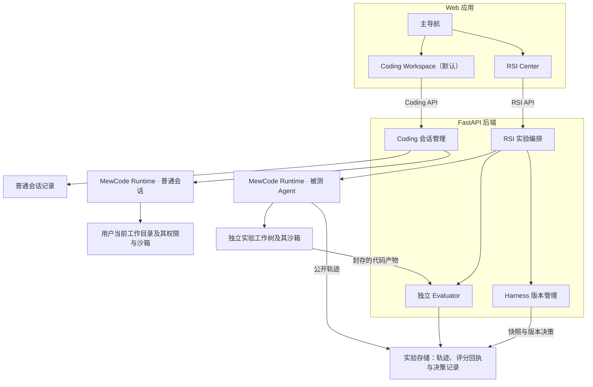

# Coding Agent Workspace 与 RSI Center 整改规格

状态：已批准。2026-11-24 用户明确批准整份规格及 AC01–AC27。批准范围包括产品目标、功能需求 F1–F24、非功能需求 N1–N13、五个交付阶段和四类后续事项。

## 背景

Helix 面向两类使用者。开发者希望在自己的仓库里完成一次修改，检查差异，运行测试，隔天还能继续追问。研究者希望固定题集、模型和 Harness，比较两次运行，并查明哪项策略改变了成绩。前者的工作单位是**会话**，后者的工作单位是**实验**。

当前 Web 应用默认进入 Overview。Coding Workspace 每次提交都会创建新作业。冻结题会经过独立评分，注册项目则从提交中提取受限的公开文件，在临时副本上执行公开测试。这条路径适合复查实验，但开发者无法在同一网页会话中接着上一轮修改自己的仓库。[前端入口](../../webdemo/frontend/src/main.tsx) · [任务提交](../../webdemo/frontend/src/pages/Workspace.tsx) · [仓库导入](../../webdemo/repositories.py) · [作业执行](../../webdemo/worker.py)

MewCode 已能流式输出回复，发出工具调用、结果、权限请求和上下文压缩通知，并能从会话记录恢复对话。现有 RSI 平台已经保存评分回执、策略快照和版本决策。拒绝候选时会保留父版本，当前 Web 手动回滚请求返回 HTTP 409。后续验收需要分别验证这两种行为。[原生事件](../../mewcode/agent.py) · [会话存储](../../mewcode/memory/session.py) · [版本决策](../../mewcode/rsi/versions.py) · [Web 版本接口](../../webdemo/api.py)

## 目标

1. **开发者打开应用即可开始编程。** 默认进入 Coding Workspace，选定本地仓库后，可以让 MewCode 解释一段代码、根据追问修改文件、运行测试并展示 Git Diff。用户可以在浏览器内处理权限请求，关闭页面后重新打开同一会话继续工作。模型回复、工具活动、测试结果都能追溯到这次真实执行。
2. **研究者有独立的 RSI Center。** 研究者选择 Benchmark、被测模型与 Harness 版本，在实验工作区中执行评测、分析失败、比较候选与父版本。既有实验、轨迹、评分回执和版本历史可继续查阅。
3. **两类任务共享 MewCode 执行内核，各自持有工作状态。** 普通会话可以在评测服务不可用时完成编程。用户明确提交后，指定任务才能成为 Benchmark 候选。实验的策略变更只作用于所选实验配置，开发者可以显式选用经验证的版本。原有 CLI 和 TUI 继续使用同一内核。
4. **先验收日常编程，再整合研究流程。** 首个产品里程碑是在浏览器里完成并恢复一次真实的多轮仓库修改。达到该里程碑后，再整合 RSI Center、打通候选任务提交，并验证从编程到版本比较的完整流程。

**已确认的工作目录选择（A）。** 普通 Coding 会话默认在用户选定的当前工作目录修改文件，能够接着尚未提交的工作继续编辑。RSI 使用独立实验工作区。

## 功能需求

### Coding Agent Workspace

| 编号 | 能力 | 用户可观察的行为 |
| --- | --- | --- |
| F1 | 工作台入口 | 打开应用即进入编程工作台。侧栏可新建会话、打开最近会话、选择项目、进入设置或 RSI Center。中央保留对话；文件、Diff、终端和工具详情按需展开，关闭详情后输入草稿仍在。 |
| F2 | 选择工作目录 | 开发者可以从 Web 浏览或输入本机工作目录。普通文件夹可直接对话、读取、授权修改文件和运行命令，保留原有目录结构。Git 仓库另外提供未提交内容和差异视图。回到已有会话仍指向原目录；选择另一个仓库开始任务时，原会话保持原绑定。原目录不可用时，页面显示原因并停止在该目录执行。 |
| F3 | 多轮对话 | 用户提交自然语言任务后，回复随 MewCode 的文本事件逐步出现。用户可以在同一会话追问上轮读过的文件、请求修改并继续调试；每轮使用当时的工作目录内容和已保存的对话上下文。 |
| F4 | 浏览、搜索和修改文件 | 用户可在面板浏览、读取文件、按名称或内容搜索，并让 Agent 在同一目录创建、编辑和删除文件。授权执行完成后，浏览器和本地编辑器可看到同一份落盘结果。被拒绝或执行失败的操作显示具体结果。 |
| F5 | Shell、终端和测试 | 用户可以让 Agent 在会话目录执行命令、运行项目测试，再根据失败输出修复并重跑。终端视图按调用展示实际命令、工作目录和已收到的输出。测试结果以真实执行证据判定；缺少退出状态或可靠的测试结论时显示「结果未知」，用户仍能查看原始输出。 |
| F6 | 执行时间线 | 每次工具调用可展开查看参数、权限决定和对应结果。并行调用或同一工具被多次调用时，结果仍归属各自的调用。仅在模型和 Runtime 实际提供可展示的思考事件时出现思考区块。轮次结束后能从摘要回看有证据的文件变更、命令、测试结果和未完成事项。 |
| F7 | 文件变更与 Git Diff | 用户可查看工作目录的新增、修改、删除和暂存状态，选择文件检查差异。工作区总览包含用户已有的改动；本轮摘要只归属有执行记录可佐证的改动。同一文件混有外部编辑且来源难以判断时标注来源未确定。 |
| F8 | 工具权限 | Web 沿用当前 MewCode 权限与沙箱策略。需要询问时，在对应调用上显示操作和目标，允许用户按现有策略选择本次允许、在标明的范围内持续允许，或拒绝并附反馈。等待期间该操作保持待处理；策略直接阻止的操作显示原因。 |
| F9 | 多会话与写入冲突 | 不同工作目录的会话可并行。两个 Web 会话指向同一实际工作树或范围重叠的工作目录时，同一时刻只允许一个会话执行可能改变该目录的操作，包括可能写文件的 Shell 命令。另一会话可继续查看，尝试写入时显示占用会话，待释放后可重试。对已读文件执行编辑时，若内容已被外部改动，应重新读取再决定如何修改。 |
| F10 | 执行状态和取消 | 用户能区分执行中、等待授权、取消中，以及已完成、失败、已取消和意外中断。用户可在执行或等待授权时取消当前轮次；相关执行停止并完成清理后才显示已取消。已落盘的改动可检查，用户可在原会话发起下一轮。 |
| F11 | 历史、断线和恢复 | 用户按仓库重新打开会话，可以查看消息、工具记录、待处理事项和最后状态。浏览器断线后重连，会补齐遗漏事件，已执行的命令只出现一次。服务重启后可以恢复已保存的对话；执行已丢失的轮次标记为中断，由用户决定是否继续。 |
| F12 | Provider 配置和切换 | 开发者可在 Web 设置中配置受支持的 Provider、模型和凭据，并看到配置或连接错误。凭据由服务端保管，保存后以掩码显示。会话可从下一轮使用新选择，已执行轮次保留当时的模型标识。演示模型明确标识；真实模型调用失败时显示错误。 |
| F13 | Skills、MCP 和 Hooks | 用户能看到当前会话可用的 Skills、MCP 服务、工具和连接状态，通过 Web 加载 Skill、管理 MCP 连接并调用已启用的扩展。扩展加载或调用失败时可见原因。现有 Hooks 按所选配置生效，Runtime 提供的 Hook 结果进入对应会话的记录。 |
| F14 | 上下文压缩 | 长对话触发压缩时，Web 展示 Runtime 报告的结果。压缩完成后继续追问，或关闭后恢复会话，都沿用该次摘要和保留的近期消息。用户仍可回看先前对话，重连或恢复不会重复发送已被摘要的历史。 |

### RSI Evaluation & Evolution Center

| 编号 | 能力 | 研究者可观察的行为 |
| --- | --- | --- |
| F15 | Benchmark 目录 | 研究者可以浏览已登记的题集、冻结版本和任务说明，选定可运行的版本。界面区分正式评测题、公开示例和待审核候选；历史成绩始终关联当时的题集版本。 |
| F16 | 批量评测 | 研究者可选择 Benchmark、被测 Agent 的 Provider、模型、Harness 快照及运行预算，启动批量评测，在独立实验工作区运行 MewCode。进度按题和运行次数展示，部分失败或中断时仍可定位对应运行。 |
| F17 | 轨迹、评分与复算 | 从一次运行可以打开按序的公开轨迹、工具结果记录、代码产物及独立 Evaluator 的评分回执。可用同一封存产物复算并比较回执。只有公开测试结果的项目显示其通过情况；正式分数必须能定位到评分回执。 |
| F18 | 失败分析与策略优化 | 研究者可发起既有进化流程，从失败分析定位到支持结论的运行和轨迹，再查看优化假设、候选对 Prompt、Skills 或 Workflow 的具体修改及验证成绩。优化只允许产生实验策略候选，MewCode Runtime 源码属于受保护输入。 |
| F19 | 快照、比较与版本决策 | 研究者可以打开同一谱系的父版本和候选快照、查看策略 Diff、逐题与汇总成绩，以及实际使用的模型和样本次数。界面展示既有规则给出的接受或拒绝结果；拒绝后，研究者仍能检查候选，活动引用继续指向原版本。 |
| F20 | 主动回滚 | 对可写实验谱系，有权限的操作者可将活动版本回滚到该谱系先前已接受的版本。操作前显示当前和目标版本，完成后可查到变更记录，下次实验使用回滚后的引用。进行中的实验保留启动时的版本；只读归档保持可查。主动回滚是本次需补齐的能力。 |
| F21 | 历史和指标 | 研究者可重开已有实验，按轮查看决策、版本和证据，区分真实模型与演示运行。成功率显示统计口径和样本数，Token、耗时与费用标明所属运行或版本。历史材料缺少某项数据时标为「未记录」。 |

### 两个子系统之间的操作

| 编号 | 能力 | 用户可观察的行为 |
| --- | --- | --- |
| F22 | 独立运行与记录 | 未配置 Benchmark 或 Evaluator 时，普通会话仍可编程；没有普通会话时，RSI 仍可运行实验。两者复用 MewCode 的执行能力。会话列表和实验历史分别管理，各自的工作目录、权限决定、取消和恢复只作用于对应任务。既有 CLI 和 TUI 继续可用。 |
| F23 | 提交 Benchmark 候选 | 用户可从一轮 Coding 任务选择题面、起始代码和可公开的验证材料，预览后明确提交。RSI 收到独立候选，原会话可以继续编辑；只有正式纳入题集后，该题才参与对应版本的评测。普通会话结束本身不会创建实验。 |
| F24 | 显式选用 Harness | 研究者为实验选择被测 Harness，开发者也可为独立的 Coding 配置选用指定的已验证版本。启动时可见具体快照，后续实验的晋升、拒绝或回滚均不会改变已启动会话或其他 Coding 配置。 |

## 非功能需求

### 运行连续性与恢复

**N1　长任务由服务端持续执行（F3、F5、F10、F16）。** 在已配置的执行预算内，切换会话、关闭所有标签页、暂时没有模型输出或终端连续输出，都不会单独导致任务结束。长输出可以分段查看或明确标注截断，仍须保留命令身份、结束状态和可用的结果。以一项预算超过 30 分钟、实际持续至少 30 分钟的本地任务作为稳定性验收样例，期间关闭页面再打开，仍能查看进度并取消。

**N2　流式事件可续读（F3、F6、F10、F11、F17）。** 正常连接时，用户在轮次结束前即可看到服务端已收到的文本片段和工具活动。SSE 断线时页面标明连接中断，保留已显示内容。重连从最后已显示的事件接续。连续断开两次，补齐后的文字、工具调用与结果、权限决定和终态仍与同次服务端记录的顺序及数量一致。续读位置失效时，从持久化记录重建视图，再接收新事件。

**N3　同一次用户操作只生效一次（F3、F8、F10、F16、F20、F23）。** 提交轮次、答复权限、取消、启动实验、回滚或提交候选时，双击或响应丢失后的重试均返回同一次操作的结果。一次轮次或运行只有一个终态。完成与取消同时到达时，两个标签页刷新后看到相同结论。重复请求不会再次执行命令或新增一条版本决定。

**N4　取消有明确的清理边界（F5、F8、F9、F10、F16）。** 接受取消后停止派发新工具，使该轮尚未答复的授权失效，并清理本轮拥有的执行进程、Shell 子进程及临时资源。清理期间显示「取消中」。超过清理时限仍不能确认停止时，显示具体阻塞原因并继续保护工作树。只有确认旧执行已失去写入能力后，其他会话才能接手。取消前已经落盘的文件改动仍可检查。

**N5　服务重启后可恢复已知进度（F6、F8、F10、F11、F14、F17）。** 已确认接收的用户消息、工具调用及已记录的结果、权限决定、压缩边界和终态在重启后可查。执行进程已丢失时，恢复对话并将当轮标为中断。若命令可能已经修改文件、结果却尚未保存，应标明「执行结果未知」并提供当前文件差异，由用户决定是否重试。恢复过程不会重发这条命令。

### 并发、权限与数据保护

**N6　并发任务各自持有执行状态（F2、F9、F12、F13、F16、F22、F24）。** 两个仓库的普通会话与一个 RSI 实验同时运行时，各自的工作目录、消息、工具结果、待授权操作和模型配置可独立核对。取消其中一个任务，其他任务继续使用各自的配置。评测设施停用时，普通会话仍可启动和恢复。编程工作区没有活跃会话时，研究者仍可独立运行实验。

**N7　按实际工作树协调写入（F2、F4、F7、F9）。** 两个标签页通过不同路径别名选中同一工作树，仍遵守 F9。独占范围涵盖文件修改和可能写文件的命令，直到写入及其子进程结束。等待的会话仍可查看文件。若用户在编辑器里改变了 Agent 即将编辑的文件，应重新读取当前版本，再决定如何修改。工作区总览与本轮变更归属分开展示，来源无法核实时保留标记。

**N8　文件操作受真实路径和现有沙箱约束（F2、F4、F5、F7、F17、F23）。** 校验范围包括文件浏览、搜索、写入、删除、Diff、终端及候选材料导出。读取已有文件和创建新文件时，均按目标或其父目录实际指向的位置检查权限。越出该操作授权范围的路径、重定向到范围外的符号链接，以及 RSI 受保护的私测与凭据，均不可通过其他视图或工具入口取得。

**N9　权限决定绑定到具体调用（F5、F6、F8、F10、F13）。** 本地 Web 入口沿用本机访问与浏览器来源限制，服务端核对会话、调用、目标和有效权限。刷新页面可看到仍有效的待授权操作。其他会话的答复，以及已取消或已失效调用的旧答复，均不能启动执行。持续授权沿用 MewCode 标明的适用范围。当前策略要求的沙箱无法启用时，在执行前报错。

**N10　服务端保管凭据（F6、F12、F13、F17、F21、F23）。** 新增或更换凭据后，重新打开设置只显示已配置状态或掩码。服务端保存的 API Key 不得出现在配置读取响应、浏览器持久存储、事件流、错误日志、会话记录或实验产物中。Provider 调用所需凭据仅交给对应调用方。项目 Shell、测试进程和待提交的 Benchmark 材料均不应继承这些凭据。

### 故障、版本与兼容性

**N11　故障原因与运行证据可区分（F5、F6、F10、F12、F17、F21）。** 页面应区分浏览器断线、Provider 错误、权限拒绝、命令失败和评测设施故障，指出受影响的轮次或运行，并保留此前证据。若进度无法写入存储，应报告保存失败，并停止派发新的写入或命令。用户可以判断是重新连接、修改配置，还是在检查工作区后重试。缺失测试结果、评分或费用时显示未知或缺失。真实 Provider 失败时保留其身份及错误。

**N12　版本变更可追溯且不会相互覆盖（F18、F19、F20、F21、F24）。** 对同一条可写谱系，晋升或回滚仅在操作者所依据的活动引用仍有效时生效。两个不同操作依据同一旧引用并发变更，至多一个成功，另一个可查到冲突和最新引用。即使操作中途服务退出，重启后也只能看到原引用及原历史，或新引用及对应的完整决策记录。已启动实验继续使用已固定的快照，后续实验读取变更生效后的版本。

**N13　历史资料和原生入口保持可用（F11、F14、F15–F22）。** 在已有数据上启动新版后，用户仍可通过原有 MewCode CLI 和 TUI 完成编程、恢复原先可恢复的会话。研究者可按原标识定位历史实验、轨迹、评分回执和快照，归档仍以只读方式访问。对照升级前后的同一批归档，原始产物内容、已记录的分数、版本关系及真实模型或演示标识均一致。

## 本轮范围与后续事项

### 本轮交付顺序

本轮包括五个阶段。Phase 2 结束时，开发者应能只用浏览器在自己的仓库完成一次真实、多轮的编程任务。达到这个里程碑后，开始整合 RSI Center。F1–F24 与 N1–N13 均属于本轮最终验收范围。

| 阶段 | 交付范围 |
| --- | --- |
| Phase 1 · 编程工作台 | 默认进入 Coding Workspace，选择本地工作目录，通过 MewCode 连续对话、读写文件、执行 Shell 和项目测试。用户能处理权限请求、查看工具结果和 Git Diff。当前目录从第一次开放写入时即遵守 F9。 |
| Phase 2 · 日常使用与恢复 | 补齐会话历史与恢复、上下文压缩、任务取消与进程回收、SSE 续读、多任务管理、Provider 配置、Skills 与 MCP 管理及 Hooks 衔接。在这一阶段验证关页重开、再提问仍能接着工作，以及已确认的 30 分钟长任务样例。 |
| Phase 3 · 独立 RSI Center | 接入既有 Benchmark、批量评测、公开轨迹、评分回执、失败分析、策略优化、快照、指标及历史归档。可写谱系交付接受、拒绝与主动回滚（F20），用户能查到每次决定的来源和结果。 |
| Phase 4 · 显式协同 | 将用户预览并选定的材料提交为 Benchmark 候选（F23），为实验选择被测配置，为独立 Coding 配置启用指定的已验证 Harness（F24）。两侧继续使用各自的工作区、历史和活动配置。 |
| Phase 5 · 完整回归 | 用真实模型完成一项编程任务，核对工具、落盘改动、测试输出、取消和恢复。跑通 RSI 评测、进化、版本比较和回滚，再核对既有归档及 CLI、TUI。最终演示串联编程、保存会话和独立启动实验的过程。 |

### 业务与数据边界

下图表示本轮交付的业务关系。两处执行都调用同一套 MewCode Runtime。每次执行使用所属业务绑定的工作目录、权限和配置。

普通会话可在没有评测设施时工作。实验编排使用实验工作树和固定的 Harness 快照，优化器的修改范围限于实验策略。两侧交换的是用户明确选定的候选材料或版本引用。会话授权、正在运行的进程、活动版本指针和私有历史均归各自业务管理。

### 留待后续版本

| 事项 | 本轮与后续的界线 |
| --- | --- |
| 完整浏览器 IDE 和交互式终端 | 本轮支持让 Agent 编辑、删除文件和执行真实 Shell 命令，用户可查看输出、测试结果与 Diff。手工代码编辑器、可直接键入命令并接管进程的交互式终端留待后续。 |
| 普通会话的分支与合并工作流 | 本轮直接使用已选工作目录，包含外部编辑检测和同一工作树单会话写入。为每个普通会话自动创建分支、提供合并界面留待后续。RSI 的独立实验工作树属于本轮。 |
| 新的 RSI 算法与评测套件 | 本轮复用现有 Evaluator、实验编排与版本规则，可运行已有 Benchmark、接收候选材料，并在可写谱系主动回滚。新的优化算法、评分体系和成套题库留待独立研究迭代。历史归档按原始记录保留。 |
| 远程托管与多人协作 | 本轮服务本机用户，支持多个会话、多个仓库和独立 RSI 实验。远程工作机、云端账户以及团队成员之间的共享授权留待后续。 |

## 验收标准

下表定义通过条件，实施验收时再填写实测结果。每条保留可复核的会话、运行或版本标识，并用同次执行的磁盘内容、进程状态、事件或评分回执核对页面。AC02 使用真实模型。需要稳定重现并行事件、错误或版本决策时，可使用标出演示来源的受控输入，仍须经过实际的后端、工具、评测或版本管理流程。

### Coding Workspace 与会话生命周期

| 编号 · 对应需求 | 验收操作 | 通过条件与核对依据 |
| --- | --- | --- |
| AC01 · F1、F2 | 从默认地址打开应用。先从普通文件夹发送首条消息，再选择含未提交改动的仓库 A，新建会话并留下输入草稿。依次打开和关闭文件、Diff、终端与工具详情，访问设置和 RSI Center。另选仓库 B，再从最近会话返回 A。最后临时移走验收用的 A。 | 普通文件夹收到回复并保留原目录结构。首次提交失败时草稿仍在，重试只产生一轮。详情收起后草稿仍在。A、B 各自显示正确目录，A 中可读到未提交的内容。移走 A 后显示目录不可用，对 A 发起的新操作不会写到 B 或其他目录。 |
| AC02 · F3、F4、F5、F7、F11 | 在含已知失败测试的本地仓库，用真实模型先解释失败原因，再追问“修复刚才的问题并重跑”。关闭页面，从历史重开原会话，追问改动了哪里。 | 轮次结束前已可见增量回复。终端有同一项测试先失败、后通过的实际输出。磁盘文件、工作台 Diff 与原仓库的 Git 差异一致。重开后仍能引用上轮改动。留存模型标识、配对的工具记录及独立重跑测试的结果。 |
| AC03 · F4、F7 | 在同一仓库预置已暂存和未暂存的用户改动。用界面按名称、内容查找文件并读取，让 Agent 创建文件、编辑已有文件、删除临时文件。在同一轮中，用外部编辑器修改同一个文件，使其中一处改动无法可靠归属。 | 文件列表、搜索命中和落盘内容一致。逐文件核对 Git 状态、暂存及未暂存差异和新增文件内容。工作区总览包含全部改动，本轮摘要仅认领有工具证据的修改，归属不明处有标记。 |
| AC04 · F5、F6 | 同名工具并行读取两个带不同标记的文件，让其中一次读取失败。分别观察 Runtime 有、无可展示思考事件的轮次，再查看一次只有输出、缺少可靠测试结论的命令。 | 时间线按调用配对参数、权限决定、输出和错误。每个标记出现在对应调用上，思考区块与可展示事件的有无一致。该命令可查看目录、命令和输出，测试结论为未知。完成摘要的改动、测试和未完成事项均能回查本轮记录。 |
| AC05 · F8、N9 | 在需要询问的模式下刷新待授权页面，分别使用本次允许、在现有策略允许范围内持续允许、带反馈拒绝。再触发策略直接拒绝的操作，尝试用另一会话或已取消调用的答复授权，并检查来源不受信与必需沙箱不可用的情况。 | 等待期间目标文件无变化。本次允许仅触发原调用一次，持续允许只对界面标明的范围有效。拒绝反馈进入对应工具结果，策略直接拒绝时显示原因。无效答复及不受信来源被拒，必需沙箱不可用时命令未启动。以操作前后文件及进程记录核对。 |
| AC06 · F9、N7 | 两个 Web 会话通过不同路径别名打开同一工作树。A 执行会写文件的命令，B 同时查看、尝试编辑和运行写命令。另在 Agent 读完目标文件后从编辑器更改它。 | A 占用期间，B 可读、写入时能看到占用会话，磁盘只有 A 的预期改动。待写进程退出后 B 重试成功。外部编辑发生后，事件顺序显示重新读取先于下一次编辑，磁盘保留用户这次改动或由用户明确处理冲突。 |
| AC07 · F10、N4 | 分别在等待授权和运行含子进程的写命令时取消。让清理延迟，再从另一会话尝试接手同一工作树。 | 可见等待授权、执行中、取消中及最终已取消。旧授权失效，取消后未派发新工具。清理逾期能看到原因且写入仍受保护。核对本轮父子进程及临时资源已回收、输出文件停止变化，其他会话才可写入。取消前的改动可查，原会话可继续下一轮。 |
| AC08 · F6、F11、N2 | 在含文本、工具、权限决定和终态的运行中断开并重连 SSE 两次，覆盖断线期间执行完毕的情况。另用失效的续读位置重新打开同一记录。 | 断线期间保留已显示内容并提示连接状态。两次重连后以及从持久记录重建后，页面文本、工具记录、授权与终态的顺序和数量均与同次服务端记录一致。磁盘副作用只发生一次。 |
| AC09 · F11、F14、N5 | 让长对话实际触发上下文压缩，记下压缩边界，继续一轮。关闭页面并重启服务，恢复后追问摘要中的事实和近期消息中的细节。 | 页面保留完整可回看的对话及压缩通知。核对恢复前后的模型输入，后续上下文包含同一摘要、保留的近期消息及之后的新消息各一次。已压缩的原始前缀不会重复送入模型。 |
| AC10 · F10、F11、N5 | 保留一个已完成的对照轮次，再在下一条写命令已留下可计数的磁盘标记、工具结果尚未保存时中断后端。重启后从历史打开会话并请求继续。 | 已确认的消息、调用、权限及此前已保存的结果仍可查，对照轮次保持已完成。当轮标为中断，该调用标为结果未知，并能查看磁盘差异。即使多次刷新，标记计数仍为一。用户可基于当前状态发起新一轮。 |
| AC11 · F12 | 通过 Web 保存两个受支持的 Provider 配置，在一次执行期间选择下一轮模型，随后用错误配置发起真实请求，再查看演示 Provider。 | 保存后密钥显示为掩码。两轮的模型标识分别与实际请求一致，前一轮历史可查。配置或调用错误能定位到所选 Provider，演示运行明确显示来源。 |
| AC12 · F13 | 通过 Web 查看并加载带可识别行为的 Skill，连接测试用 MCP 服务、调用其工具、断开连接。运行一次已配置的 Hook，并分别制造扩展加载或连接失败。 | Skill 的实际加载和使用可查，MCP 列表与连接状态一致，工具输出含服务返回的标记。Hook 返回的结果只在对应会话出现。加载与连接失败均显示具体来源和原因。 |
| AC13 · N1、F10 | 在预算超过 30 分钟的同一个本地任务中安排一段静默期和一段较长输出。切换会话、关闭所有页面，再重新打开。任务实际持续至少 30 分钟后从 Web 取消。 | 服务端开始与取消时间相差至少 30 分钟，关页前后的运行标识相同，重新打开可看到期间的实际进度。长输出可分段读取或明确标注截断，命令及最终状态可查，取消按 AC07 完成清理。 |

### RSI Center 与系统协同

| 编号 · 对应需求 | 验收操作 | 通过条件与核对依据 |
| --- | --- | --- |
| AC14 · F15、F16 | 浏览正式题、公开示例和待审核候选。选择已有冻结题集、Provider、模型、Harness 快照和运行预算，执行多题多次评测。在其中一次运行中制造可识别的中断。 | 目录能区分三类任务，且可查题面与版本。逐题核对运行次数、状态、实际配置和实验目录。中断可定位到具体运行，其他已完成记录仍可查看，普通工作树无实验改动。历史成绩指向原冻结版本。 |
| AC15 · F17 | 从一个已评分运行打开公开轨迹、工具结果、封存代码和独立评分回执。对同一封存产物复算，再查看一个仅有公开测试结果的示例。 | 事件顺序、产物标识、原回执与该运行对应，复算回执的评分及产物依据与原件一致。示例只显示有证据的公开测试结果，正式分数均可打开其独立回执。 |
| AC16 · F18、F19 | 在独立实验中运行既有进化流程，使同一谱系出现一次接受和一次拒绝。由失败分析打开证据，比较父版本和候选，检查每轮策略与验证成绩。 | 失败结论指向相应运行和轨迹。假设、Prompt、Skills 或 Workflow 的实际差异与两个快照相符。用评分回执核对逐题分、汇总分、模型和样本数。接受后活动版本前移，拒绝后保留原活动版本且候选仍可查。执行前后 Runtime 源码摘要一致。 |
| AC17 · F20、N12 | 在可写谱系内，由有权限的操作者回滚到先前已接受版本。另分别让两次版本变更基于同一旧引用并发提交，并在版本变更期间中断服务。分别尝试对只读归档、其他谱系的目标和未获接受的候选发起回滚。 | 正常回滚前可见当前和目标版本，成功后有且只有一条对应决策。已启动实验继续用原快照，新实验使用回滚后的版本。并发时至多一次变更生效，冲突方可查最新引用。重启后的引用和决策要么均为变更前状态，要么均体现完整变更。无效目标的回滚被拒，活动引用和只读归档内容保持原值。 |
| AC18 · F21 | 重新打开含真实模型及演示运行的历史实验，逐轮查看指标，挑选一组有完整记录和一组有缺项的样本。 | 运行来源、轮次与归档一致。从原始回执和用量记录重算页面标明口径的成功率、样本数、Token、耗时与已记录费用，数值一致。缺项显示未记录。 |
| AC19 · F22、N6 | 同时运行两个仓库的普通会话和一个 RSI 实验，分别设置可区分的模型配置、目录和任务标记。取消一个任务。另在评测设施停用时新建及恢复普通会话，再在没有普通会话时运行实验。 | 目录、消息、授权、工具结果与模型标识只属于各自任务。取消其中一个，另外两个仍推进。两种单独运行的情形各自完成，普通会话与实验只出现在对应历史中。 |
| AC20 · F23 | 完成普通任务，记录实验与候选数量。选择该轮题面、起始代码、可公开验证材料，预览并提交。随后在原会话继续编辑。 | 普通轮次结束时没有新增实验或候选。显式提交后新增一个独立候选，内容逐项匹配预览，保留任务开始时的代码，后续编辑不改变候选。候选在待审核状态下不进入正式评测，既有冻结题集内容一致。 |
| AC21 · F24 | 为被测 Agent 和一项独立 Coding 配置显式选用已验证的快照，保留另一个使用原配置的会话。随后在 RSI 中推进版本、拒绝候选并回滚。 | 从各次实际启动记录可核对所选快照。已启动会话与另一配置的版本均保持原值，明确选用新快照的配置按该快照运行。 |

### 一致性、数据保护与完整回归

| 编号 · 对应需求 | 验收操作 | 通过条件与核对依据 |
| --- | --- | --- |
| AC22 · N3 | 对提交轮次、答复权限、取消、启动实验、主动回滚、提交候选分别重送同一次操作，覆盖双击和响应丢失后重试。另让完成与取消同时到达。 | 每组重送只生效一次。两次答复对应同一工具结果，两次取消对应同一终态。执行标记、实验、回滚决定和候选的新增数量分别与单次提交相同。竞态结束后两个标签页及持久记录显示同一个终态。 |
| AC23 · N8 | 在临时验收环境准备允许访问的文件、指向授权范围外的测试链接和标为私测的测试材料。分别检查浏览、搜索、创建、编辑、删除、Diff、Shell、实验公开轨迹及候选导出。 | 授权范围内的正常操作成功。各入口按实际目标或新文件父目录检查权限。受限测试材料的标记未出现在结果、公开轨迹或导出中，受限目标的目录清单与文件摘要前后一致。 |
| AC24 · N10 | 用可识别的测试凭据配置本地测试 Provider，各完成一次正常调用和一次错误调用。检查配置读取响应、浏览器持久存储、事件、错误日志、会话记录、实验产物及候选材料，并在项目 Shell 和测试进程内核对是否继承该凭据。 | 目标 Provider 确认收到测试凭据，设置页只显示掩码。其余各处的标记匹配数为零。验收记录只保留检查位置和匹配数量。 |
| AC25 · N11 | 分别触发断线、Provider 调用失败、权限拒绝、命令失败和评测设施不可用。再使验收用进度存储暂时无法写入，观察后续工具派发。 | 每类故障均显示来源、受影响的运行及适当的恢复动作，此前的证据仍可查。真实模型错误保留模型身份。缺少依据时测试、评分或费用显示未知或缺失。存储故障可见，期间没有新的写入或命令被派发。 |
| AC26 · N13、F22 | 用升级前可恢复的原生会话和历史实验归档副本建立对照。升级后从既有 CLI、TUI 入口执行编程及其原先支持的续聊，再从 RSI Center 按原标识查看历史材料。 | 原生入口仍可完成工具调用并恢复相应会话。逐项比对轨迹、回执、快照与代码产物的内容摘要，以及分数、版本关系和模型来源。对照值一致，归档保持只读。 |
| AC27 · F3、F11、F16、F18、F19、F22 | 在同一次产品演示中完成 AC02 的真实多轮编程并保存会话。进入 RSI Center，选择冻结 Benchmark 和被测 Harness，启动进化，打开一次失败分析、候选策略修改和版本比较，最后返回原会话。 | 从会话标识可查工具记录、Diff 与测试输出，从实验标识可查失败轨迹、策略 Diff、评测回执与版本决定。返回工作台后仍可从原目录、原配置和保存的上下文继续编程。 |
